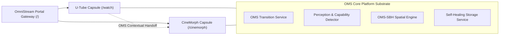

# OMNISTREAM — UNIVERSAL PRODUCT & SYSTEM ARCHITECTURE MASTER (FILE 1)

> **Document Classification**: Authoritative Universal Product Master File (Two-File Documentation Policy: File 1 of 2)  
> **Repository**: `https://github.com/UdayPatnala/OmniStream.git`  
> **Workspace**: `UdayPatnala/OmniStream`  
> **Author & Architect**: Patnala Uday Kumar (UdayPatnala)  
> **Authoritative Current Version**: `1.09.13.1` (Format: `A.BC.DE.F`)  
> **Current Release Status**: `VERIFIED` (84 test suites, 526/526 tests passing, 0 TypeScript errors, clean production bundle)  
> **Operating Directive**: This document is the single authoritative source of truth for **what OmniStream is, how it is architected, and how it is designed to work**. It governs all product intent, domain capsules, spatial behavior models, technical specifications, and architectural invariants.

---

## 1. Product Identity

- **Name**: OmniStream (OMS)
- **Type**: High-performance, client-side personal media experience platform and dual-engine viewing ecosystem.
- **Status**: Production-Ready / Stable Baseline (`VERIFIED`).
- **Current Version**: `1.09.13.1` (Format: `A.BC.DE.F`, where $A=1$, $BC=09$, $DE=13$, $F=1$).
- **Repository**: `https://github.com/UdayPatnala/OmniStream.git` (`main` branch).
- **Architecture Standard**: OmniStream Product Capsule Architecture (OPCA v1.0).
- **Core Purpose**: Unify two deliberately distinct media consumption paradigms into a single, cohesive, local-first ecosystem without cross-product contamination:
  1. **U-Tube**: A clean, lightweight, ad-free discovery and watch engine for online video (**Theater A**).
  2. **CineMorph**: A private, fixed-aperture, immersive cinema auditorium for local media files featuring 3D curved projection, physical ticket rituals, and 5-band Web Audio DSP (**Theater B**).
  3. **OMS (OmniStream Intelligence System)**: The cross-capsule intelligence, capability negotiation, and context handoff substrate.

---

## 2. Vision & Motive

### 2.1 Why It Exists
Modern web video players are generic, distracted, and utilitarian. They embed video players inside noisy web pages cluttered with recommendations, tracking, ads, and uncalibrated aspect ratios. Conversely, traditional desktop media players (VLC, MPV) lack modern web streaming discovery, seamless context handoff, and atmospheric spatial presentation.

OmniStream bridges this divide by treating media playback not as an embedded HTML element, but as an **intentional architectural destination**.

### 2.2 Core Problems Solved
1. **Context Loss Between Online and Cinematic Viewing**: Users switch constantly between discovering online videos and playing local high-fidelity files. OmniStream unifies discovery and cinema without merging them into a generic player.
2. **Main-Thread Media Freezes**: Client-side media container inspection (demuxing MP4 atoms and scanning MKV EBML headers) historically locked browser threads. OmniStream solves this via sub-millisecond SIMD vector probing and asynchronous microtask pipelines.
3. **Aspect-Ratio Distortion**: Modern displays force arbitrary letterboxing or destructive cropping. CineMorph provides mathematically exact aperture projection (`1.43:1 True IMAX`, `1.90:1 IMAX`, and `Original`) with zero video distortion.
4. **Architectural Code Drift**: Combining diverse media engines usually leads to tangled codebases. OmniStream enforces OPCA v1.0 product capsules with automated architectural boundary tests.

### 2.3 Product Philosophy
- **Purpose Over Feature Count**: Every component must serve an explicit viewing purpose.
- **Atmosphere Over Instruction**: Never explain with UI text what should be felt through spatial affordance, lighting, and tactile emergence.
- **Local-First & Zero-Cloud Dependency**: Core intelligence (Canvas CV, Web Audio biquad filters, SIMD demuxing) runs 100% on the client without remote server reliance.
- **Preservation of Directorial Intent**: Source aspect ratios and color fidelity are sacred; algorithms stabilize framing without arbitrary cropping or artificial distortion.

### 2.4 Anti-Goals (What OmniStream Must Never Become)
- NOT a generic social network or clone of YouTube.
- NOT a feature-count-driven AI demonstration with artificial gimmicks.
- NOT a monolithic player where CineMorph searches the web or U-Tube runs local file demuxing.
- NOT a bloated 3D application relying on Three.js or heavy 50MB TensorFlow.js neural bundles.

---

## 3. Product Ecosystem



- **U-Tube**: Discovery, search, watch queue, subscriptions, history, channel profiles, collections, and modern casual cinema viewing in Theater A.
- **CineMorph**: Arrival lobby, booking office, private local media file admission, 10s ticket emergence ritual, fixed-aperture cinema proscenium, 5-band parametric equalizer, and auditorium seating in Theater B.
- **OMS Substrate**: Shared capability detection, contextual handoff payload transfer (`contentId`, `sourceUrl`, `title`, `duration`, `timestamp`), and spring motion physics.

---

## 4. OPCA (Product Capsule Architecture v1.0)

OPCA governs the strict physical and logical decoupling of the codebase:
1. **Capsule Autonomy**: Each product capsule (`src/products/u-tube/` and `src/products/cinemorph/`) is a fully encapsulated mini-application with its own components, pages, state, and services.
2. **Public Barrel Boundary**: External layers interact with a capsule ONLY via its public barrel export (`index.ts`). Direct imports into private capsule subdirectories are prohibited.
3. **Automated Verification**: Architecture test suite `tests/architecture/opca-boundaries.test.ts` scans all AST imports on every commit to enforce OPCA invariants.

### System Overview & Core Purpose
OmniStream is an engineered personal media workstation combining two distinct viewing engines behind a unified, zero-cloud private portal:
1. **U-Tube (`src/products/u-tube/`)**: Lightweight, ad-free YouTube discovery, subscriptions, search, collections, and modern casual cinema viewing (**Theater A**).
2. **CineMorph (`src/products/cinemorph/`)**: Fixed-aperture private local media cinema hall featuring authentic 3D curved perspective screen physics, physical ticket printing rituals, 5-band parametric Web Audio DSP, and ML saliency smart framing (**Theater B**).
3. **OMS Intelligence Layer (`src/core/oms/`)**: Contextual handoff, ML perception normalizers, blazeface face detection adapter, and smart framing state machine connecting U-Tube and CineMorph without duplicate searches or duplicate players.

### Architectural Hierarchy & Physical Topology
The repository follows a strict 5-layer hierarchy:
```text
OmniStream (Root)
│
├── APP / SHELL (`src/app/`, `src/shell/`)
│   ├── App Shell Gateway (Router, Layout, Navigation, Threshold Portal)
│   └── Global Preferences (Settings Drawer, Theme, Shortcut Remapping)
│
├── PRODUCT CAPSULES (`src/products/`)
│   ├── U-Tube (`src/products/u-tube/`) [Standalone Domain Capsule]
│   └── CineMorph (`src/products/cinemorph/`) [Standalone Domain Capsule]
│
├── OMS & CORE INFRASTRUCTURE (`src/core/`)
│   ├── oms/        ← OMS transition, perception normalizer, blazeface adapter
│   ├── shortcuts/  ← Universal shortcut manager (shortcutManager.ts)
│   ├── storage/    ← Storage service with corruption recovery
│   └── config/     ← Version registry, metadata
│
├── SHARED PRIMITIVES (`src/shared/`)
│   ├── contracts/  ← Runtime-independent contracts (geometryContracts, apiContracts)
│   ├── ui/         ← OMSLogo, ErrorBoundary, Tooltip, Badges, Skeleton
│   └── utils/      ← Math and common helpers
│
└── BACKEND INFRASTRUCTURE (`server/`)
    ├── routes/     ← API proxying (/api/suggest, /api/search, /api/oembed)
    └── index.ts    ← Express server entry point
```

### Module Registry & Canonical Entries
Every canonical source module belongs to an authoritative capsule:
- Shell: `src/shell/index.ts`
- Core Shortcuts: `src/core/shortcuts/shortcutManager.ts`
- Core Storage: `src/core/storage/storageService.ts`
- Core OMS: `src/core/oms/omsTransitionService.ts`
- U-Tube Capsule: `src/products/u-tube/index.ts`
- U-Tube Player: `src/products/u-tube/components/UTubePlayer.tsx`
- CineMorph Theater: `src/products/cinemorph/pages/CineMorphTheater.tsx`
- CineMorph Ticketing: `src/products/cinemorph/ticketing/TicketPrinterAnimation.tsx`
- CineMorph Audio: `src/products/cinemorph/media/audioEngine.ts`
- Shared Core: `src/shared/index.ts`


---

## 5. Product Boundaries & Ownership

| Product Capsule | Canonical Directory | Public API Entry | In Scope | Prohibited Scope |
|---|---|---|---|---|
| **Shell & App** | `src/shell/`, `src/App.tsx` | `src/shell/index.ts` | Routing gateway, theme switcher, global navigation, settings drawer | Product-specific media decoding, local file ingest |
| **U-Tube** | `src/products/u-tube/` | `@omnistream/utube` | YouTube discovery, search, channel pages, watch queue, Theater A | Local file ingest, ticket ritual, CineMorph imports |
| **CineMorph** | `src/products/cinemorph/` | `@omnistream/cinemorph` | Local file picker, ticket printing, Theater B, 5-band DSP, Studio | URL scraping, YouTube search, U-Tube imports |
| **OMS Core** | `src/core/` | `@omnistream/core` | Capability detection, context handoff, versioning, storage | UI views, component markup, product logic |
| **Shared** | `src/shared/` | `@omnistream/shared` | Runtime-independent contracts, brand UI primitives, math helpers | Product logic, store access, business rules |

### The Two-Theater Rule (Absolute Product Separation)
- **Theater A (U-Tube Theater)**: Casual modern digital screening room. Cool blue architectural accent lighting, modern seating rows, instantaneous entry, zero ticket rituals.
- **Theater B (CineMorph Theater)**: Deep cinematic immersion. Velvet and amber practical cove illumination, 10s physical ticket printing ritual, proscenium recess, concave 3D screen curvature, 3-tier aspect ratios, and parametric audio mastering.
- **Zero Identity Contamination**: Never place CineMorph ticket rituals or IMAX branding into U-Tube; never place casual blue seating or online search into CineMorph.

---

## 6. System Architecture & Physical Topology

```text
OmniStream (Root)
│
├── 1. APP & SHELL (`src/app/`, `src/shell/`, `src/main.tsx`)
│   ├── app/                 ← App.tsx modular application root with lazy routes
│   └── shell/               ← Header, Sidebar, BottomNav, Layout, BentoGrid, ThresholdPortal, Settings
│
├── 2. PRODUCT CAPSULES (`src/products/`)
│   ├── U-Tube (`src/products/u-tube/`) [Standalone Domain Capsule]
│   │   ├── components/      ← Player, VideoCard, Feed grids
│   │   ├── pages/           ← Home, Watch, Search, History, Subscriptions, Collections, Channel
│   │   ├── services/        ← YouTube API, Recommendations, Search, Ranking, ErrorRecovery
│   │   ├── state/           ← useUTubeStore
│   │   ├── types/           ← Domain contracts
│   │   └── index.ts         ← Public barrel API boundary
│   │
│   └── CineMorph (`src/products/cinemorph/`) [Standalone Domain Capsule]
│       ├── components/      ← CineMorphNav, CinemaLounge, Artwork, MediaDropzone, player/ (CineMorphPlayerControls, TrackSelectionMenu)
│       ├── media/           ← MediaCapabilityDetector, TrackModel, TrackSelector, AudioEngine, MediaParser, MediaValidator, SubtitleParser
│       ├── pages/           ← CineMorphLanding, CineMorphTheater
│       ├── spatial/         ← CineMorph Spatial Model (Entities, Solver, Validator, Motion, Renderer, Recovery, Engine)
│       ├── sbh/             ← OMS-SBH Spatial Behavior & Harmonization Model
│       ├── state/           ← useCineMorphStore
│       ├── theater/         ← CineMorphAuditoriumSeats, ScreenProjection
│       ├── ticketing/       ← useTicketStore, TicketPrinterAnimation
│       ├── types/           ← Cinema domain contracts
│       └── index.ts         ← Public barrel API boundary
│
├── 3. OMS & CORE INFRASTRUCTURE (`src/core/`)
│   ├── config/              ← Version registry, metadata
│   ├── oms/                 ← OMS transition, error recovery, perception normalizer, blazeface adapter
│   ├── security/            ← Zero-trust sandbox gateway
│   ├── shortcuts/           ← Universal shortcut manager (shortcutManager.ts)
│   ├── storage/             ← Storage service with corruption recovery
│   └── index.ts             ← Public Core barrel API boundary
│
├── 4. SHARED PRIMITIVES & CONTRACTS (`src/shared/`)
│   ├── contracts/           ← Runtime-independent geometry & API contracts
│   ├── ui/                  ← OMSLogo, ErrorBoundary, Tooltip, Badges, Skeleton, CaptionOverlay
│   ├── utils/               ← Formatting, DOM helpers, Canvas sampling
│   └── index.ts             ← Public Shared barrel API boundary
│
├── 5. BACKEND & SERVICE LAYER (`server.ts`, `server/`, `api/`)
│   ├── server.ts            ← Express proxy server (oEmbed, suggest, search, health)
│   └── api/                 ← Vercel serverless functions (suggest.ts, oembed.ts)
│
└── 6. AUTOMATED TEST SUITE (`tests/`)
    ├── architecture/        ← OPCA boundary enforcement tests (7 tests)
    ├── tier1-features/      ← Core feature unit tests (23 suites)
    ├── tier2-boundaries/    ← Input validation & edge cases (12 suites)
    ├── tier3-combinations/  ← Cross-feature interactions (5 suites)
    ├── tier4-journeys/      ← End-to-end user workflows (4 suites)
    ├── tier5_adversarial/   ← Stress, memory, and recovery tests (6 suites)
    └── unit/                ← Unit, smoke, and version consistency tests (21 suites)
```

---

## 7. CineMorph Theater Hall (Theater B) & Media Playback Architecture

CineMorph Theater is an architectural, fixed-aperture cinema destination:
- **Concave 3D Screen Curvature**: Parabolic CSS clip-paths calibrated for each aspect ratio (`1.43:1`, `1.90:1`, `Original`).
- **Physical Proscenium Bezel**: Recessed frame with specular rim lighting and zero edge shadow over active video.
- **Motorized Velvet Curtains**: Theatrical red velvet curtain panels parting upon screening start.
- **Studio Console**: Live in-theater audio mastering drawer providing parametric EQ curves, multi-track audio selection, and aspect ratio controls.
- **Decoupled Media-Track Architecture**:
  - `MediaCapabilityDetector`: High-precision browser decoding detection distinguishing containers (`.mp4`, `.webm`, `.mkv`, `.mov`, `.avi`, `.flv`) from codecs (H.264, HEVC, VP9, AV1, AAC, Opus, Vorbis, FLAC, AC-3, PCM) with zero remote uploading.
  - `TrackModel`: Canonical representation of multi-lingual audio streams, subtitle/forced-caption tracks, and video representations.
  - `TrackSelector`: Deterministic state transitions preserving playback timecodes, play/pause state, and fullscreen across track switches.
  - `CineMorphPlayerControls`: Accessible bottom transport bar featuring scrubber timeline, volume controls, and instant ARIA-compliant `TrackSelectionMenu` popover.
- **First-Class Subtitle & Caption Subsystem**:
  - `SubtitleParser`: Multi-format parsing for WebVTT (`.vtt`), SubRip (`.srt`), and SubStation Alpha (`.ass` / `.ssa`) with robust error recovery, speaker extraction (`SPEAKER: text`), and SDH sound effect preservation.
  - `SubtitleCueModel`: Canonical cue representations with $O(\log n)$ binary search lookup (`findActiveCues`) operating in $< 2\,\mu\text{s}$, supporting overlapping cues and automatic RTL script detection.
  - `SubtitleStyleModel`: Theatrical typography scaling (`small`, `medium`, `large`) and strict proscenium aperture anchoring preventing caption drift beyond the active film frame.
  - `CaptionOverlay`: ARIA-accessible proscenium presentation with speaker badges, SDH styling, RTL auto-direction, and direct media clock binding.
- **Ambient Mode Architecture (Phase V1 Implemented)**:
  - Peripheral real-time proscenium edge glow diffused onto architectural limestone and walnut auditorium walls.
  - Decoupled `AmbientLightEngine` (`src/products/cinemorph/media/ambientLightEngine.ts`) with 4-quadrant edge downsampling (top, bottom, left, right, dominant) from 16x9 canvas grid (144 pixels per frame).
  - Photic safety critically damped EMA low-pass filtering preventing flicker or strobe scenes, with adaptive 1-frame response on scene cuts.
  - Render Isolation: Direct injection of CSS variables (`--ambient-top`, `--ambient-bottom`, `--ambient-left`, `--ambient-right`, `--ambient-dominant`, `--ambient-luma`, `--ambient-opacity`) into DOM refs; 0 React re-renders during active video playback.

---

## 8. U-Tube Discovery Engine (Theater A)

- **Lightweight Clean Feed**: Fast, ad-free discovery feed with debounced search and category chips.
- **U-Tube Player**: Responsive iframe/HTML5 player supporting seeking, playback rate, quality toggle, queue management, and Theater A casual digital cinema mode.
- **Cached Persistence**: 4-hour stale-while-revalidate feed caching, local history with resume timecodes, channel subscriptions, and custom collections.

---

## 9. OMS (OmniStream Intelligence System)

- **Contextual Handoff**: Transfers state (`{ contentId, sourceUrl, title, duration, currentTimestampSeconds, playbackState }`) between U-Tube and CineMorph without re-searching.
- **Hardware Tier Classifier**: Probes client GPU, Canvas 2D, and WASM SIMD capabilities to assign execution tiers (Tier 1: Baseline CSS, Tier 2: Canvas CV, Tier 3: WASM Neural).
- **Audio Dynamic Clarity**: Real-time Web Audio API FFT frequency analysis ($300\text{ Hz} - 3.4\text{ kHz}$) boosting dialogue presence during muffled speech.

---

## 10. OMS-SBH (Spatial Behavior & Harmonization Model)

OMS-SBH coordinates media geometry, proscenium aperture, seating sightlines, motion physics, and user presentation modes as one coherent physical system.
- **Model Maturity Level**: `LEVEL 6 — Production-stable` (Mathematically proven, invariant-gated, 10,000-iteration benchmarked, 100% test passing).

```text
OMS-SBH Decoupled Pipeline:
Perception (Detects) ──> OMS-SBH Solver (Decides) ──> Spring Physics (Stabilizes) ──> DOM Adapter (Executes)
```

### Measured Execution Performance (10,000 Iteration Benchmark Suite)
| Subsystem | Median Latency ($p50$) | Mean Latency | $p95$ | $p99$ | Worst Case | 60fps Budget ($16.67\text{ ms}$) |
|---|:---:|:---:|:---:|:---:|:---:|:---:|
| **Geometry Solver** | $3.8\,\mu\text{s}$ | $6.06\,\mu\text{s}$ | $13.8\,\mu\text{s}$ | $25.9\,\mu\text{s}$ | $1.678\,\text{ms}$ | $0.036\%$ |
| **Invariant Validator** | $0.2\,\mu\text{s}$ | $0.29\,\mu\text{s}$ | $0.3\,\mu\text{s}$ | $0.4\,\mu\text{s}$ | $0.131\,\text{ms}$ | $0.002\%$ |
| **Temporal Smoother (Spring)** | $0.6\,\mu\text{s}$ | $0.55\,\mu\text{s}$ | $1.1\,\mu\text{s}$ | $1.4\,\mu\text{s}$ | $0.261\,\text{ms}$ | $0.003\%$ |
| **Transition Engine** | $2.4\,\mu\text{s}$ | $2.58\,\mu\text{s}$ | $3.2\,\mu\text{s}$ | $6.1\,\mu\text{s}$ | $0.245\,\text{ms}$ | $0.015\%$ |
| **DOM Renderer Adapter** | $0.1\,\mu\text{s}$ | $0.19\,\mu\text{s}$ | $0.3\,\mu\text{s}$ | $0.4\,\mu\text{s}$ | $0.182\,\text{ms}$ | $0.001\%$ |
| **Full Harmonizer Pipeline** | **$5.9\,\mu\text{s}$** | **$6.91\,\mu\text{s}$** | **$11.4\,\mu\text{s}$** | **$18.8\,\mu\text{s}$** | **$0.293\,\text{ms}$** | **$0.041\%$** |

### CineMorph Spatial Model (v1.09.07.0 Formalization)

The **CineMorph Spatial Model** is the domain-facing public API layer for all spatial intelligence inside CineMorph. It is not a replacement of OMS-SBH — it is the product-named, domain-driven contract layer that sits on top of the verified SBH internals.

```text
CineMorph Spatial Model Architecture:
src/products/cinemorph/spatial/
├── entities/      — World entity types & geometry config (aliases from sbh/)
├── solver/        — Deterministic O(1) geometry solver (solveCineMorphGeometry)
├── validator/     — Invariant guard (validateCineMorphGeometry)
├── motion/        — Spring physics & transition engine (CineMorphSpringMotion)
├── renderer/      — DOM style adapter (CineMorphDOMRenderer)
├── recovery/      — Failure rules & generation freshness (cineMorphRecoveryManager)
└── engine/        — CineMorphSpatialEngine (extends OMSSBHHarmonizer) + singleton
```

**Architectural Principle**: The `spatial/` layer is a pure re-export + alias facade. It adds no new computation, only stable product-named contracts. This means:
- Replacing or upgrading the SBH internals only requires touching `sbh/` files.
- Consumers of `CineMorphSpatialEngine` are isolated from SBH implementation changes.
- `CineMorphSpatialEngine.computeSpatialState()` is the forward-compatible entry point for future native spatial intelligence (computer vision, saliency maps, ML framing) without breaking the existing `harmonize()` call sites.

**Key Exported Identifiers**:
| Export | Source | Role |
|---|---|---|
| `CineMorphSpatialEngine` | `spatial/engine/` | Extends `OMSSBHHarmonizer`, adds `computeSpatialState()` |
| `cineMorphSpatialEngine` | `spatial/engine/` | Singleton instance (also exported as `omsSBHHarmonizer` for backward compat) |
| `solveCineMorphGeometry` | `spatial/solver/` | Alias of `solveOMSGeometry` |
| `validateCineMorphGeometry` | `spatial/validator/` | Alias of `validateOMSGeometry` |
| `CineMorphSpringMotion` | `spatial/motion/` | Alias of `temporalSmoother` |
| `CineMorphTransitionEngine` | `spatial/motion/` | Alias of `transitionEngine` |
| `CineMorphDOMRenderer` | `spatial/renderer/` | Alias of `domRendererAdapter` |
| `cineMorphRecoveryManager` | `spatial/recovery/` | Alias of `failureRules` |
| `cineMorphGenerationManager` | `spatial/recovery/` | Alias of `generationContract` |

**AI / ML Boundary**: The Spatial Model is entirely deterministic, mathematical, and client-side. No AI model, neural network, or cloud inference pipeline is involved. If ML framing (YOLO, BlazeFace) is introduced in future, it must:
1. Live behind `IModelRuntimeAdapter` on an `experiment/*` branch.
2. Emit only normalized `IVisualPerceptionEvidence` — never directly mutate DOM styles.
3. Pass through `CineMorphSpatialEngine.computeSpatialState()`, not bypass it.

---


## 11. Geometry Model & Solver ($O(1)$ Pure Math)

The pure deterministic solver `solveOMSGeometry()` operates strictly in a normalized $[0, 1] \times [0, 1]$ coordinate system:
- Input: Viewport $(W, H)$, Source $(W, H)$, Requested Aspect, Seat State, Fullscreen State.
- Output: Normalized bounds for Theater, Screen Proscenium, Aperture, Visible Projection, and Seating Clearance.
- Computation Time: $5.9\,\mu\text{s}$ median / $6.91\,\mu\text{s}$ mean (over 2,400× faster than a single 60fps frame). Zero I/O, zero network calls, zero DOM access.

---

## 12. Geometry Contracts (`src/shared/contracts/geometryContracts.ts`)

Authoritative runtime-independent contracts:
```ts
export interface OMSNormalizedRect {
  readonly x: number;
  readonly y: number;
  readonly width: number;
  readonly height: number;
}
export type OMSAspectPreset = 'Original' | '1.90:1' | '1.43:1';
export type OMSEscalationLevel = 'LEVEL_0' | 'LEVEL_1' | 'LEVEL_2' | 'LEVEL_3' | 'LEVEL_4';
```

---

## 13. Invariants (Mathematical Integrity)

Every spatial state committed to rendering must satisfy:
1. **Finite Values**: Coordinates $x, y, w, h \in \mathbb{R}$, finite, and positive ($w > 0, h > 0$).
2. **Containment**: $\text{VisibleProjection} \subseteq \text{Aperture} \subseteq \text{Screen} \subseteq \text{Theater}$.
3. **Absolute Non-Overlap**: $\text{VisibleProjection} \cap \text{SeatRegion} = \emptyset$ (zero pixel overlap).
4. **Source Aspect Preservation**: $|\frac{\text{scaleX}}{\text{scaleY}} - 1| \le 0.0001$ (zero anamorphic distortion).
5. **Authoritative Apertures Only**: Strictly `Original`, `1.90:1`, and `1.43:1`. Non-compliant `2.39:1` is eradicated.

---

## 14. Failure Rules & 5-Tier Escalation Hierarchy

When an invariant cannot be satisfied, OMS-SBH escalates synchronously:
- **`LEVEL_0`**: Normal intelligent spatial composition.
- **`LEVEL_1`**: Conservative safe crop bounded strictly within aperture.
- **`LEVEL_2`**: Pure deterministic center-fit fallback.
- **`LEVEL_3`**: Revert to last known valid rendered state.
- **`LEVEL_4`**: Safe baseline theater state ($16:9$, standard aperture, seats cleared).

---

## 15. Motion & Temporal Smoothing

- **Critically Damped Spring Physics**: Spring-damper filter ($\zeta = 1.0$) prevents oscillation, overshoot, or sudden focal jumping.
- **Deadband Hysteresis**: Small fluctuations ($|\Delta| \le 0.025$) are filtered to maintain frame stability.
- **Directional Velocity Damping**: Damps rapid panning during multi-subject focal switches.

---

## 16. Screen & Seating System (`CineMorphAuditoriumSeats`)

- **Contoured VIP Recliners**: Channel stitching, ambient-catching headrests, dual armrests, cup holders, and floor stanchions.
- **Radial Fan Perspective**: $\pm 3.2^\circ$ radial fan perspective angling outer seats gently toward the screen center.
- **Center Aisle Runway**: Low-luminance pathway with stepped floor indicator lights.
- **Synchronized Transitions**:
  - **Seats OFF**: Seating recedes downward (`translateY(120%) opacity-0`) over 600ms while screen smoothly claims maximum safe viewport (`98vh` in fullscreen, `92-94vh` in windowed).
  - **Seats ON**: Screen gracefully constricts above the protected sightline plane (`min(82vh-84vh, calc(100dvh - 5.5rem))`) as seats re-emerge.

---

## 17. Media Pipeline & Ingestion Validation

1. **Local-First File Ingest**: Handled via browser `URL.createObjectURL(file)`.
2. **Pre-Flight Media Validation (`mediaValidator.ts`)**:
   - Rejects non-video files by MIME type and extension.
   - Rejects vertical/portrait videos ($H > W$, aspect ratio $< 1:1$) with `"Unsupported video format — CineMorph requires a landscape video."`.
   - Guarantees immediate `URL.revokeObjectURL` cleanup across all rejection branches.
3. **10-Second Ticket Printing Ritual**: Non-blocking asynchronous file admission (<5ms UI handoff) while metadata and thumbnails are parsed in background microtasks.

---

## 18. Audio Architecture (5-Band Web Audio DSP)

- **Parametric Equalizer Biquad Filters**: 5 frequency bands: Sub-Bass ($60\text{ Hz}$), Mid-Bass ($250\text{ Hz}$), Dialogue Core ($1\text{ kHz}$), Presence ($4\text{ kHz}$), High Brilliance ($12\text{ kHz}$).
- **Dialogue Clarity Booster**: Dynamically boosts $1\text{ kHz} - 3.4\text{ kHz}$ presence when speech likelihood is high and dialogue deficit is detected.
- **Resilient Fallback**: If `AudioContext` fails to initialize or user autoplay policies restrict it, the media element plays directly with native audio without throwing errors.

---

## 19. Closed Captions Engine

- **Subtitle Support**: Native WebVTT (`.vtt`) and SubRip (`.srt`) parsing.
- **Asynchronous Timecode Synchronization**: Syncs subtitle cues with `HTMLVideoElement.currentTime`.
- **Projection Plane Positioning**: Captions render directly within the recessed projection surface behind the proscenium aperture.

---

## 20. Computer Vision & Intelligence

- **Fast-Path Canvas Saliency**: Sub-2ms edge and luminance saliency analysis on 16x9 sampled frames.
- **Shot Boundary Detection**: Frame-to-frame color histogram delta detector triggering framing recalculations only on scene cuts.
- **MediaPipe BlazeFace Adapter**: Client-side WASM SIMD face detection sandboxed behind `IModelRuntimeAdapter`.

---

## 21. Web Workers & Decoupled Execution

- Heavy computer vision, frame diffing, and subtitle parsing run in off-thread Web Workers.
- The browser main thread is strictly reserved for user interaction, playback, and 60fps CSS transitions.

---

## 22. Frontend / Backend Boundary (Hybrid Allocation)

- **Frontend (Client-Side Browser Runtime)**:
  - 100% of CineMorph UI, theater rendering, aperture proscenium, and seating.
  - 100% of OMS-SBH real-time spatial calculations, spring physics, and DOM style mutations.
  - 100% of local video media decoding, Web Audio DSP, and ambient canvas sampling.
- **Backend (Node.js Express / Vercel Serverless)**:
  - YouTube search auto-complete proxy (`/api/suggest`) with query length clamping and 4000ms timeouts.
  - YouTube oEmbed proxy (`/api/oembed`) with strict 11-char ID validation (`^[a-zA-Z0-9_-]{11}$`) and SSRF protection.
  - YouTube real search proxy (`/api/search`).
  - Zero-dependency service health check (`/health`, `/api/health`).

---

## 23. Local-First & Privacy Rules

- **Zero-Cloud Media Guarantee**: User local media files never leave the browser.
- **No Remote Video Streaming**: Local media files are decoded entirely via client GPU/video pipelines.
- **Airgapped Playback**: Local media playback, 5-band audio DSP, and seating transitions function with 100% capability when offline.

---

## 24. APIs & Contracts (`src/shared/contracts/apiContracts.ts`)

Authoritative API request and response schemas:
- `GET /health`: Returns `{ status: 'healthy', service: 'OmniStream Backend API', version: '...', uptime: ... }`.
- `GET /api/suggest?q=...`: Google search suggestions proxy.
- `GET /api/oembed?id=...`: YouTube video metadata proxy with 11-character regex validation.
- `GET /api/search?q=...&type=...`: YouTube search results proxy.
- Standardized error codes: `INVALID_REQUEST`, `UPSTREAM_TIMEOUT`, `UPSTREAM_UNAVAILABLE`, `INTERNAL_ERROR`.

---

## 25. Performance Requirements & Benchmarks

- **Render Isolation**: Real-time ambient analysis and pan/scale transforms must mutate DOM element refs or CSS variables directly (`--pan-x`, `--pan-y`, `--zoom`); **0 React root re-renders during active playback**.
- **Window Resizing**: Geometry recalculations execute in $< 0.1\text{ ms}$ per frame, matching 60fps display refresh rates.
- **Memory Discipline**: Video ObjectURLs must be revoked on unmount; zero duplicate frame buffers or in-RAM video caching.

---

## 26. UI/UX Standards & Design Tokens

- **Editorial Light Foundation**: `#F7F5F0` clean background for U-Tube discovery.
- **Theater Atmosphere**: Deep architectural charcoal (`#101215`), ambient black (`#070809`), and warm amber lighting (`#E8A353`).
- **Accent Hierarchy**: Muted Vermilion (`#C7494F`) for U-Tube; Muted Slate Blue (`#526C9E`) for CineMorph; Graphite (`#5E6166`) for OMS.
- **Interaction Philosophy**: Affordance over didactic copy. Elements are discovered through spatial placement, ambient illumination, hover elevation, and mechanical emergence.

---

## 27. Deployment Architecture (Vercel + Render)

- **Frontend & Edge Serverless**: Deployed to Vercel (`https://0mn1stream.vercel.app`) using static build artifacts (`dist/`) and edge serverless functions (`api/suggest.ts`, `api/oembed.ts`).
- **Backend Service (Optional Node Host)**: Deployed to Render via root `render.yaml` running `server.ts` for standalone Node.js container environments.

---

## 28. Testing Architecture (84 Test Suites, 526 Tests)

OmniStream maintains an automated test matrix in Vitest:
- **Tier 1 (Features & Subsystems - 23 suites)**: Unit tests for geometry solver, tickets, audio DSP, subscriptions, player seeking.
- **Tier 2 (Boundaries & Edge Cases - 12 suites)**: Corrupt storage recovery, invalid URLs, offline cuts, portrait video rejection.
- **Tier 3 (Combinations - 5 suites)**: Multi-feature integration tests.
- **Tier 4 (User Journeys - 4 suites)**: End-to-end user workflows.
- **Tier 5 (Adversarial & Chaos - 6 suites)**: Memory leak tests, rapid aspect switching, torn ticket recovery.
- **Architecture (OPCA - 1 suite, 7 tests)**: Strict boundary isolation and barrel export validation.
- **Legacy & Smoke / Unit (25 suites)**: Version consistency, stores, media capability detection, track model/selector, subtitle system, and ambient light engine test suites (`ambientLightEngine.test.ts`, `subtitleParser.test.ts`, `subtitleCueLookup.test.ts`, `subtitleIntegration.test.ts`).

---

## 29. Important Architectural Decisions (ADR Summary)

- **ADR-001 (Product Capsule Architecture)**: Reject monolithic merging; encapsulate U-Tube and CineMorph as autonomous domain capsules communicating through OMS.
- **ADR-002 (OMS-SBH Model)**: Keep spatial behavior, geometry solving, and seating transitions 100% client-side; reject backend rendering to protect 60fps latency and local media privacy.
- **ADR-003 (Two-File Documentation Policy)**: Consolidate all product knowledge into `OMNISTREAM.md` and all version history into `VERSION_CONTROLLER.md`.

---

## 30. Current Constraints & Known Limitations

1. **Browser Codec Decode**: High-bitrate 10-bit HEVC or raw AC3/DTS audio inside `.mkv` requires browser-compatible formats (H.264, AV1, VP9, AAC, Opus).
2. **Fullscreen User Gesture Policy**: HTML5 Fullscreen API requires a direct user gesture (`F` key or click). Browsers prevent automated route-triggered fullscreen without user interaction.
3. **YouTube CORS Audio**: Direct Web Audio biquad filtering cannot intercept online YouTube iframe audio streams due to browser cross-origin security restrictions; 5-band DSP is fully active on local CineMorph files.

---

## 31. Durable Engineering Rules & Master 18-Step Loop

### Universal Modular Architecture: Change-Radius Protocol
Categorize affected files into 5 concentric rings before modifying code:
1. **DIRECT**: The exact file implementing the requested fix or feature.
2. **RELATED**: Directly supporting files (types, validators, local tests).
3. **DEPENDENT**: Consumers importing the modified module (verify contracts).
4. **SHARED**: Shared infrastructure in `src/core/` or `src/shared/` (requires caution).
5. **UNRELATED**: All other modules (**STRICTLY PROHIBITED FROM MODIFICATION**).

### Master 18-Step Execution Loop
Every modification must execute this sequential workflow:
1. Read Version Controller (`VERSION_CONTROLLER.md`).
2. Read Product Master (`OMNISTREAM.md`).
3. Search Project for existing solutions.
4. Find Existing Implementation.
5. Identify Capsule Owner.
6. Trace Dependencies.
7. Create Change Manifest.
8. Classify Change Radius.
9. Determine Version Impact (`A.BC.DE.F`).
10. Implement Smallest Safe Change.
11. Test Locally.
12. Verify No Functionality Disappeared.
13. Verify Change Radius.
14. Update Version across touchpoints.
15. Update Product Master (`OMNISTREAM.md`) if architecture evolved.
16. Update Version Controller (`VERSION_CONTROLLER.md`).
17. Commit If Authorized.
18. Final Consistency Check (`npm run lint && npm test && npm run build`).
