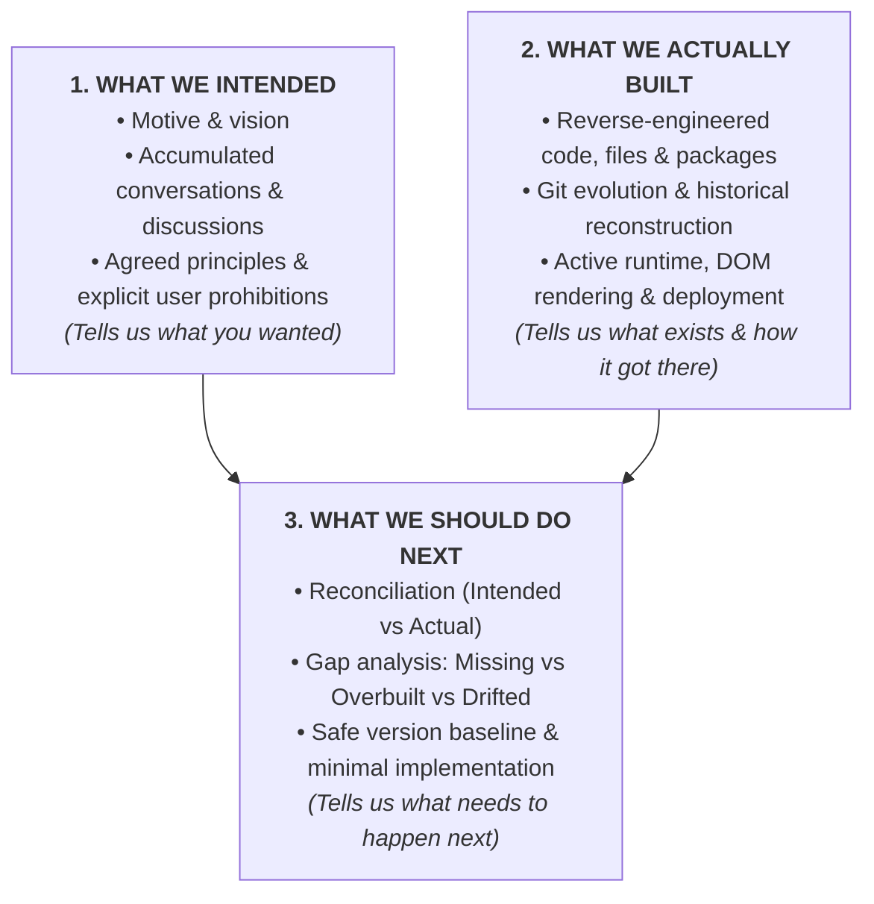
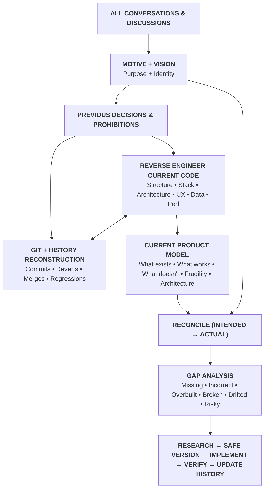

# Universal Product Reverse-Engineering + Engineering System

**Document Authority**: OMS-DOC-PROTO-UNIVERSAL-03  
**Scope**: Universal across OmniStream, AROH products, and all autonomous agent executions.  
**Standard**: SYS-SYS Master Reverse-Engineering & Architectural Invariants (L0 Foundation)  
**Permanent Status**: MANDATORY — ENFORCED ON EVERY TASK  

---

## The Three Realities to Reconcile

> **"Conversation history tells it what you wanted.**  
> **Reverse engineering tells it what exists.**  
> **Git tells it how it got there.**  
> **The comparison tells it what needs to happen next."**

---

## Architectural Reconciliation Model

---

## 0. Absolute Order of Operations

**NEVER START BY CODING.**

The mandatory order is:

1. **A. RECOVER PRODUCT INTENT**
2. **B. REVERSE ENGINEER CURRENT PRODUCT**
3. **C. RECONCILE INTENT VS IMPLEMENTATION**
4. **D. IDENTIFY GAPS / EXCESS / RISKS / DRIFT**
5. **E. RESEARCH**
6. **F. MAKE DECISIONS**
7. **G. PLAN**
8. **H. PRESERVE SAFE VERSION**
9. **I. IMPLEMENT**
10. **J. VERIFY**
11. **K. AUDIT**
12. **L. UPDATE HISTORY**
13. **M. PRESERVE NEW KNOWN-GOOD VERSION**

Do not skip the reverse-engineering stage because the task sounds simple.

---

## 1. Product Intent Recovery

Before touching implementation, recover the project's accumulated product intent from all available sources. Search and inspect relevant previous conversations and discussions.

Recover:
- Original motive and why the project exists.
- The real problem being solved.
- Product purpose, vision, and long-term direction.
- Intended users and use cases.
- Product identity and intended experience.
- Intended behavior and visual language.
- Product principles and unique characteristics.
- Agreed features vs. proposed, rejected, deferred, or removed features.
- Explicitly forbidden approaches and design decisions.
- Previous architecture and technical decisions and their underlying reasons.
- Known problems, previous mistakes, lessons learned, and known limitations.
- Deployment decisions, performance expectations, and security/privacy expectations.
- Established terminology.

---

## 2. Reverse Engineer What Has Actually Been Built

After recovering the intended product, reverse-engineer the existing project **BEFORE** deciding what to change. Answer: **"WHAT EXISTS RIGHT NOW?"**

### 2.1 Project Structure
Inspect directories, applications, packages, modules, components, services, utilities, scripts, configuration, assets, documentation, tests, and deployment files. Determine what each major area actually does.

### 2.2 Technology Stack
Identify languages, frameworks, libraries, runtime, build systems, package managers, databases, storage, APIs, auth, hosting, deployment, third-party services, browser APIs, AI/ML models, and media processing. Determine which technologies are actually used versus merely listed in manifests.

### 2.3 Application Architecture
Reverse engineer entry points, rendering models, server/client boundaries, routing, state management, data flow, component hierarchy, service boundaries, API flow, persistence, caching, error flows, and deployment flows. Determine the actual architecture rather than relying on README claims.

### 2.4 User Experience Flow
Trace real user journeys:
$$\text{START} \longrightarrow \text{USER ACTION} \longrightarrow \text{UI} \longrightarrow \text{STATE} \longrightarrow \text{LOGIC} \longrightarrow \text{API} \longrightarrow \text{DATA} \longrightarrow \text{RESULT}$$
Identify loading, empty, success, error, retry, and unavailable states. Determine what the user can actually do today.

### 2.5 UI Reverse Engineering
Inspect the interface as a product: page structure, typography, spacing, color usage, responsive behavior, interaction patterns, visual hierarchy, navigation, temporary/dead/fake UI, placeholders, and generic patterns. Compare actual UI behavior against recovered vision.

### 2.6 Data Model
Reverse engineer entities, relationships, schemas, storage, persistence, transformations, validation, lifecycle, and deletion/update behavior. Identify unnecessary duplication and fragile data flows.

### 2.7 Dependency Graph
Determine which packages are actually imported, where they are used, critical vs. unnecessary dependencies, duplicated capabilities, heavy dependencies, and obsolete packages. Never remove dependencies without verified usage audits.

### 2.8 Performance Model
Inspect bundle size, code splitting, rendering isolation, hydration/client JS, network requests, waterfalls, API frequencies, media loading, expensive calculations, repeated renders, event listeners, timers, memory usage, resource cleanup, and caching.

---

## 3. Git-Based Reverse Engineering

Use Git as a historical reconstruction tool, not just version control:
- Inspect current status, branch, commit, tags, releases, and complete available history.
- Inspect file history, blame, merges, reverts, and architectural transitions.
- Determine how the project evolved: what was added, removed, reverted, replaced, broken, and repaired.
- Identify safe known-good versions and where regressions originated.
- Never inspect only the latest 5–10 commits; examine the full trajectory.

---

## 4. Documentation Reverse Engineering

Inspect `README`, `VERSION_HISTORY.md`, `EXECUTION_HISTORY.md`, specifications, architecture docs, and notes. Compare documentation against actual code:
- Documented but not implemented.
- Implemented but not documented.
- Outdated documentation.
- Conflicting documentation.

---

## 5. Build the Current-State Model

Synthesize reverse engineering into a concrete operational map:
- **What Exists**: Working, partially working, broken, unused, dead, experimental, temporary, production-critical, user-facing, internal, well-architected, fragile, over-engineered, under-engineered.
- **Risk Classification**: Known safe areas, high-risk areas, and unknown areas (never pretend unknown areas are understood).

---

## 6. Reconcile Three States

$$\text{State A (Intended Product)} \quad \longleftrightarrow \quad \text{State B (Actual Implementation)} \quad \longleftrightarrow \quad \text{State C (Requested Change)}$$

- **A vs B $\to$ Product Drift Analysis**: Did we build what was intended?
- **B vs C $\to$ Implementation Impact Analysis**: What does the change affect in the real system?
- **A vs C $\to$ Product Alignment Analysis**: Does the requested change serve the product vision?

---

## 7. Product Drift Analysis

Audit whether the project has drifted from its original motive/vision:
- Feature creep, generic UI, unnecessary functionality, lost functionality.
- Wrong terminology, incorrect workflows, visual drift.
- Technical decisions that distort UX.
- Abandoned concepts still present as zombie code.
- Temporary implementations that became permanent technical debt.

---

## 8. Gap Analysis

Categorize findings across six dimensions:
1. **Missing**: Agreed features, required behavior, critical states, UX, accessibility, tests.
2. **Incorrect**: Behavior, UI, architecture, data flow, performance.
3. **Unnecessary**: Features, dependencies, components, APIs, abstractions, effects, code.
4. **Broken**: Runtime errors, build failures, broken workflows, broken integrations.
5. **Risky**: Fragile architecture, security leaks, data corruption risks.
6. **Unknown**: Areas requiring further targeted investigation.

---

## 9. Feature Forensics

For every major feature:
- Why does it exist? When was it introduced? What problem does it solve?
- How does it currently work? What files implement it?
- What dependencies does it use? What depends on it?
- Is it complete? Does it match the vision? Should it remain?
- If history shows it was previously removed or rejected, do NOT casually reintroduce it.

---

## 10. Research

Only after understanding the product intent and current implementation, research the technical options:
1. *What is technically possible?*
2. *What is technically appropriate?*
3. *What is appropriate for THIS product?*
Stop researching when sufficient evidence exists for a sound decision.

---

## 11. Decision-Making Framework

Evaluate against: Product motive, vision, existing intended behavior, current implementation, user request, security, data integrity, reliability, simplicity, maintainability, performance, accessibility, privacy, deployment constraints, zero-budget constraints, and reversibility.

---

## 12. Simple Working Model First

For any uncertain or high-risk task:
1. Create the simplest viable implementation.
2. Make it work.
3. Verify it.
4. Preserve it as a recovery baseline.
5. Only then attempt advanced optimization.

---

## 13. Safe Version Protocol

Before risky changes, create a recoverable checkpoint (commit, tag, safe branch, backup). Always know the current safe version and how to return to it.

---

## 14. Implementation Discipline

Implement only after intent is recovered, the current system is reverse-engineered, history is inspected, gaps are identified, decisions are made, and safe versions are preserved. Prefer incremental changes over sweeping rewrites.

---

## 15. If the Direct Solution Fails

Do not simply stop. Investigate *why* it failed. Evaluate alternatives: platform-native capabilities, different libraries/APIs/algorithms, server vs. client boundaries, compatibility layers, approximations, or staged rollouts.

---

## 16. Zero-Budget Policy

Assume zero budget. Prefer open source, free tiers, native browser APIs, local tooling, and existing dependencies. Never introduce recurring costs without explicit approval.

---

## 17. Engineering Quality

Evaluate correctness, complexity, maintainability, time/space/rendering complexity, memory usage, bundle size, security, privacy, accessibility, and testability. Prefer the smallest solution that properly solves the problem.

---

## 18. UI & Product Authenticity

The product must look and behave like the product defined by its vision, not like generic AI-generated software. Eliminate generic text, excessive glassmorphism, pointless animations, and dead controls.

---

## 19. Security & Privacy

Audit secrets, environment variables, auth tokens, input validation, injection, XSS, CSRF, CORS, unsafe file handling, and sensitive logs. Minimize data collection.

---

## 20. Testing & Verification

Verify functionality, automated tests, types (`tsc --noEmit`), linting, build (`npm run build`), runtime behavior, responsive UX, accessibility, and performance.

---

## 21. Deployment Discipline

Verify local production build before deployment. Audit Vercel/Render configurations, environment variables, headers, redirects, and runtime logs.

---

## 22. Git Safety

Inspect `git status` and `git diff` before and after work. Never destroy unrelated work or run destructive Git operations without safe backups.

---

## 23. Token & Resource Efficiency

Target inspections, avoid dumping enormous unchanged files, reuse discovered context, and make focused edits. Optimize for correct long-term project evolution.

---

## 24. Multi-Session Continuity

Preserve safe states, current status, completed work, unfinished work, known risks, and rollback points at every stopping point so the next session can resume cleanly.

---

## 25. Version & Execution History Integrity

Maintain `VERSION_HISTORY.md` and `EXECUTION_HISTORY.md`. Read before every task; update honestly after completion. Never rewrite history to hide failures.

---

## 26. Final Forensic Audit

Compare Original Motive vs Current Product, Original Vision vs Current Product, Previous Decisions vs Current Product, and Current Product vs New Implementation.

---

## 27. Continuous Discovery

Continuously identify missing, overbuilt, broken, duplicated, outdated, or risky areas. Prioritize by P0 (Critical) to P4 (Future) without derailing the active task.

---

## 28. Master Execution Loop

$$\begin{aligned}
&\text{Recover Conversations} \to \text{Recover Motive} \to \text{Recover Vision} \to \text{Recover Decisions} \\
&\to \text{Reverse Engineer Current Product} \to \text{Inspect Code/Architecture} \to \text{Inspect Runtime/UX/Data} \\
&\to \text{Inspect Complete Git History} \to \text{Inspect History Ledgers} \to \text{Compare Intended vs Actual} \\
&\to \text{Identify Drift, Missing, Over-Applied, Broken, Risky} \to \text{Research} \to \text{Decide} \to \text{Plan} \\
&\to \text{Safe Checkpoint} \to \text{Simple Working Model} \to \text{Verify} \to \text{Refine} \to \text{Test} \\
&\to \text{Security/Privacy/Perf/UX Checks} \to \text{Deployment Check} \to \text{Git Diff Check} \\
&\to \text{Update History Ledgers} \to \text{Preserve Known-Good Version} \to \text{Final Product-Vision Check} \to \text{Finish}
\end{aligned}$$

---

## 29. Non-Negotiable Principles

1. Understand the motive before the feature.
2. Understand the vision before the implementation.
3. **Reverse engineer the existing product before changing it.**
4. Treat conversations as accumulated product knowledge.
5. Treat Git as historical evidence.
6. Treat code as evidence of actual implementation, not proof of intent.
7. Reconcile intent, history, and implementation.
8. Search before creating.
9. Preserve known-good versions.
10. Build simple working versions before advanced ones.
11. Fix root causes.
12. Prefer reversible changes.
13. Do not overwrite unrelated work.
14. Do not invent product facts.
15. Do not fabricate completion.
16. Do not over-engineer.
17. Do not feature-bloat.
18. Do not introduce costs without approval.
19. Use model/tool resources efficiently.
20. Large work may continue across sessions.
21. Maintain project history after every meaningful task.
22. Always leave the project in a recoverable state.
23. When direct implementation fails, investigate alternatives.
24. Preserve product identity through every technical change.
25. **The ultimate question**:
    > *"Does the resulting product move closer to the product we originally intended, while becoming more correct, maintainable, secure, efficient, and usable?"*
